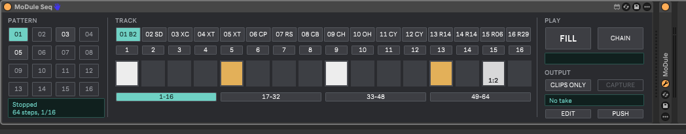
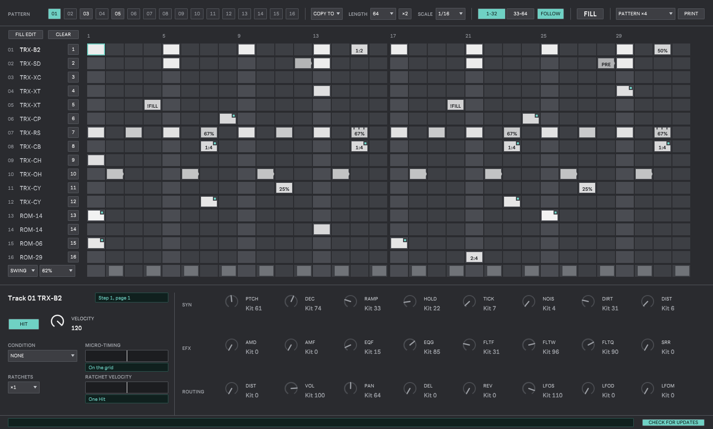

# MoDule Seq

A step sequencer for MoDule, the Machinedrum's engines as a VST3, as a Max for Live device. It plays MoDule's 16
Tracks live from Ableton Live, with the Machinedrum's ideas: Hits with velocity, parameter Locks on each step, trig
Conditions, ratchets, micro-timing, swing, Accent, Slide, a Fill, 16 Patterns and chains. It can also print a Pattern,
or capture what it played, into Live clips that play MoDule without it.

Up to 0.1.1 the device was called MD Drums Seq, and the plug-in MD Drums.

Version 0.2.0, a preview: Windows only.

## Requirements

- Windows 10 or 11, 64-bit.
- Ableton Live 12 with Max for Live (developed and measured on Live 12.2.1).
- MoDule ([releases](https://github.com/c0remusic/MModule/releases)), or MD Drums, its name up to 0.1.1: 0.1.0 or
  later plays the Hits and the Locks; 0.1.1 or later also names the Tracks after their Machines and shows the Kit's
  values on the Lock knobs (with 0.1.0 the Tracks show their numbers). The Accent and the Slide need a MoDule that
  reads them (notes 88 and 89-114): MoDule 0.1.2 or later.

## Install

1. Unzip `MModuleSeq-<version>-win64.zip`.
2. Put the `MoDule Seq` folder into Live's User Library, under `Presets/MIDI Effects/Max MIDI Effect/`. Keep its
   two files together: the device loads its engine, `mdseq.mxe64`, from its own folder. Remove an older
   `md-drums-seq` folder, from 0.1.1 or before: its engine has the same name, and Max loads only one. In a set made
   with MD Drums Seq, put MoDule Seq in its place.
3. Start Live (or restart it: Max never loads a new version of an engine it has already loaded).

## Set up

Put **MoDule Seq** on a MIDI track, in front of **MoDule**. The device sends each Track's Hits (notes 36-51) and its
Locks (notes 64-87) to MoDule through the track. MoDule tells the device its Kit through a small file in the system's
temporary folder: the device then names each Track after its Machine and shows the Kit's values.

## Use

The device has two surfaces.



**The strip**, in Live's device chain, plays:
- the 16 Patterns (filled: playing; bright: holds Hits; faint: empty; blinking outline: queued for the end of the
  Pass). Choosing a Pattern while Live plays queues it;
- the Tracks, by their Machines, and their Mutes (coral: muted);
- the 16 steps of the Track shown, page by page (the pages past the Pattern's length are off); a click toggles a
  Hit;
- FILL, held to play the steps whose Condition is FILL (and silence those with !FILL);
- Chain: on, the Pattern buttons clicked make a chain; off, it plays, each Pattern for one Pass, round and round. A
  Pattern chosen by hand ends it;
- Edit, which opens the window, and Push, which plays the device from Push 2 (below);
- Capture, which writes the last take (what the device played since the transport last started) into a Session clip
  per Track, named "Take n", as Print places its clips; its length shows under it;
- Clips only: on, the device stops playing MoDule, so that printed or captured clips play it alone.



**The edit window** edits:
- the grid, 16 Tracks by 32 steps (two halves for 64): a click on an empty cell puts a Hit and selects the step; a
  click on a Hit selects it; a click on the selected step toggles its Hit, so a double-click takes a Hit off; a drag
  paints Hits, or takes them off when it starts on one;
- the trig row under the grid, one of three as the menu at its left chooses, each for every Track as on the
  Machinedrum: Swing (the steps that play late by the Pattern's swing, set beside it), Accent (every Hit of an
  accented step plays louder than velocity 127 can, at 128 + 2 x the amount set beside it; the strip marks those
  steps in amber; needs a MoDule that reads note 88) or Slide (on a marked step, each Track's locked values
  glide to those of its next Hit; needs a MoDule that reads notes 89-114);
- Copy to (the Pattern shown over another), Length, x2 (twice as long, the steps again after them), Scale, Follow,
  Print and its menu;
- Fill edit (Hits put with the mouse take the Condition FILL) and Clear (the Pattern back to empty);
- the step panel: Hit, velocity, Condition, micro-timing, ratchets and their velocity curve, and the 24 Locks. A
  Lock's knob sits on the Kit's value until turned; a double-click gives a control back its default (the Kit for a
  Lock).

Live's undo (Ctrl+Z) gives back a Pattern copied over, cleared or edited, and a chain: the set keeps them.

The "Pattern" parameter can be automated in the Arrangement, set per scene by a clip envelope in Session, or mapped
to a controller. A change takes effect at the end of the Pass playing, as on Elektron's machines.

**Print** writes the Pattern shown, over 1 to 16 Passes, or the last take as Capture does, as its menu chooses, into
a Session clip per Track, on the MIDI tracks routed to MoDule's Track channels ("3-MoDule" for Track 3), creating
those that are missing. Turn Clips only on to hear the clips alone.

**Push 2.** With Push on, the device takes Push 2 while it is on and its track is selected, and gives it back to Live
otherwise. The four top rows of pads are the 32 steps of the Track shown (Page left and right for steps 1-32 and
33-64): a tap puts a Hit or takes one off; held, the step's Locks are on the eight encoders, SYN1-8, EFX or ROUTING
as the first three buttons under the display choose. Bottom left, the 16 Tracks, laid out as a Drum Rack: a pad
shows its Track; with Mute held, or tapped to latch it, a pad mutes or unmutes it. Bottom right, the 16 Patterns.
Delete held clears a step or a Pattern; Duplicate held copies the first Pattern pressed over the second; Double
doubles the Pattern; Accent held toggles a step in the Accent row.

**Updates.** At most once a day, as it loads, the device asks GitHub for the newest release of MoDule Seq (one
HTTPS request to api.github.com; nothing else is sent, nothing is downloaded or installed) and shows a line under the
strip's pages when it is newer than the one running. "Check for updates", in the edit window, turns this off for
every set. The day of the last check and the switch are kept in `%LOCALAPPDATA%\md-drums-seq\settings.txt`.

## Timing

Measured in Live 12.2.1 at 44.1 kHz with MD Drums, as MoDule was then called: played live by the device, from its
printed clips, and from a clip made by hand, the attacks land on the same sample, 2 samples after the grid once Live
has compensated the plug-in's latency, with no measurable jitter.

## Build from source

Windows, Visual Studio 2022, CMake 3.25 or later, Python 3; the first configure fetches Cycling '74's `max-sdk-base`.

```
cmake -S . -B build -G "Visual Studio 17 2022" -A x64
cmake --build build --config Release -j 6
ctest --test-dir build -C Release --output-on-failure
cmake --build build --config Release --target zip_release
```

The device and its engine land in `build/device`, the zip in `build`.

## Licence

GPL-3.0-or-later: see `LICENSE.md`. Third-party notices, the Max SDK's licence among them: `NOTICE.md`.
